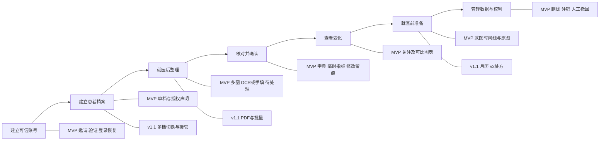

# 03 用户故事地图与清单

状态：设计评审稿，验收均未执行。

## 目标、产出与下一步

目标：按患者记录旅程组织工作，而不是按技术分层交付。产出：故事地图、18条MVP故事及Given/When/Then验收。下一步：将故事拆成Issue，并关联RTM和测试证据。

## 故事地图

## MVP故事与验收

每条US对应同号FR和TC，例如US-001→FR-001→TC-001。全部P0；扩展故事在路线图评审后新增编号。

| 故事 | 用户价值 | Given（前提） | When（行为） | Then（预期） |
| --- | --- | --- | --- | --- |
| US-001 | 受邀用户建立可信账号 | 有效邀请码与邮箱 | 开通并验证链接 | 激活成功；无效/过期链接拒绝；未验证真实上传和恢复均拒绝 |
| US-002 | 用户安全登录恢复 | 已验证账号 | 登录/退出/请求恢复 | 原密码不可见；恢复只到已验证邮箱；令牌使用后失效 |
| US-003 | 家属明确为谁记录 | 已登录且无档案 | 选择画像、填写昵称与授权声明 | 建一档、保留声明时间；第二档被业务拒绝，画像不改变权限 |
| US-004 | 用户保存一份历史多页报告 | 合法文件且权限满足 | 选择多图与检查日上传 | 一报告关联多图；检查日非上传日；原图可找回 |
| US-005 | 用户自行判断重复 | 相同内容图片已存在 | 再次上传 | 提示可能重复，可继续或取消；不同照片不自动合并 |
| US-006 | 用户节省录入时间 | 已保存原图 | 同意OCR或拒绝OCR | 同意产生草稿并保留原始结果；拒绝可手填；草稿不入图 |
| US-007 | 用户纠正识别错误 | 有草稿含值、单位、日期 | 对照原图修改并确认 | 未确认必填字段阻止提交；确认后只生成一次正式记录 |
| US-008 | 用户找到相同指标 | 存在别名及未知项 | 完成字段映射 | 别名归标准项；未知项保留来源，不默默丢弃或入图 |
| US-009 | 用户关注自己的指标 | 有正式与未映射数据 | 搜索、确认临时项、关注拖序 | 名称次数单位准确；临时项仅本档待归并；不能凭空创建 |
| US-010 | 用户看长期趋势 | 多日期不同单位的数据 | 选区间与单位组 | 真时间轴且分组；零点/一点不造趋势；不自动换算 |
| US-011 | 用户理解报告变化 | 范围缺失、前零、同日多次等边界数据 | 查看卡片与图 | 逐报告范围、歧义提示、前零不算百分比、非精确项列表，不评病情 |
| US-012 | 用户快速继续操作 | 本人/代管及空/非空账号 | 打开首页 | 文案遵画像；六默认关注；待处理数、1～3就诊、上传入口清楚 |
| US-013 | 用户准备就医沟通 | 已有报告与不同检查日 | 添加就诊并关联报告 | 保存就诊日医院备注；按日期倒序；次数按就诊非报告 |
| US-014 | 用户修正正式记录 | 已确认记录已有图表 | 更改值/日/单位 | 原图OCR不改写；新增修改记录；图表更新且分组重新计算 |
| US-015 | 用户继续中断工作 | 上传/OCR失败或未确认 | 重试或继续核对 | 保留已有成功步骤、有限重试；任务重启不重复正式保存 |
| US-016 | 用户控制保存内容 | 报告在列表与图表 | 选择移除或彻底删除 | 移除提示保留范围；彻删立即不可访问，关联清除按确认期限执行 |
| US-017 | 患者/用户行使权利 | 有注销或撤回请求 | 完成身份/授权关系核验 | 撤回后阻断代管，按规则处置、反馈；不将他人声明当本人证明 |
| US-018 | 维护者管理元数据 | 拥有有限维护权限 | 更新字典/邀请 | 操作留最小审计；无法借维护权限打开病历或原图 |

## 补充安全场景

两名用户各有档案，任何一方替换报告、图片、指标、就诊、修改记录ID时，系统拒绝访问。草稿未经确认不得通过图表接口间接读取为正式数据。恢复演练后已彻删内容不得重新可见。这些是跨故事NFR，不因页面看似正常就视为通过。

## 待确认事项

- [ ] 将同日歧义、删除生命周期和临时指标可比性拆为更细测试案例。
- [ ] 空状态逐字文案及易用性观察脚本。
- [ ] v1.1和v2的新增故事由版本评审确定，不计入MVP完成率。
