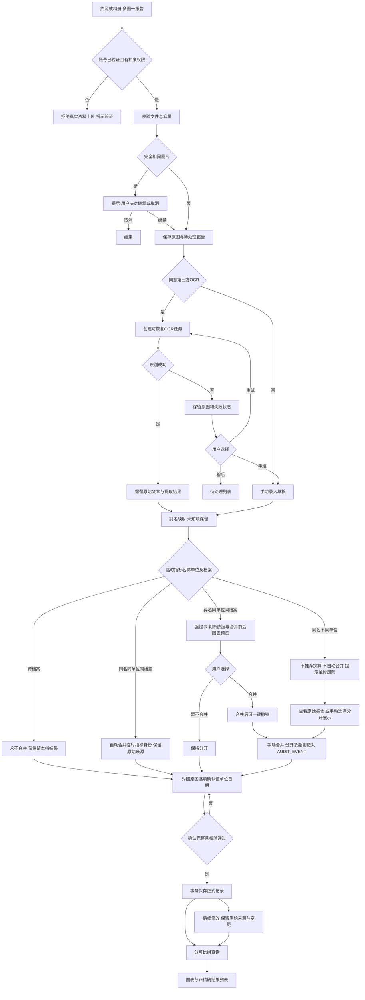
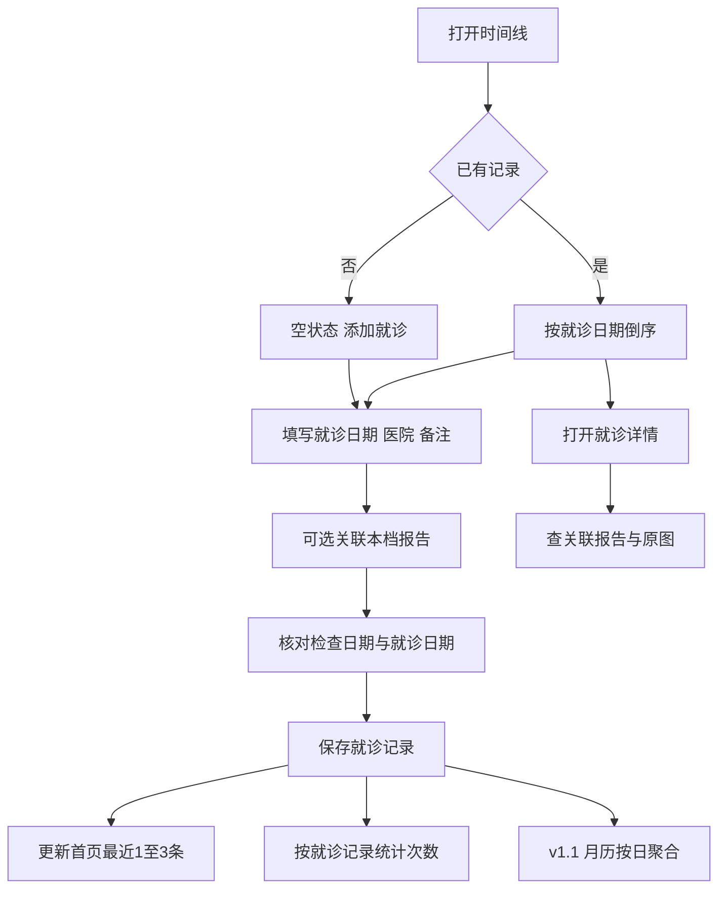
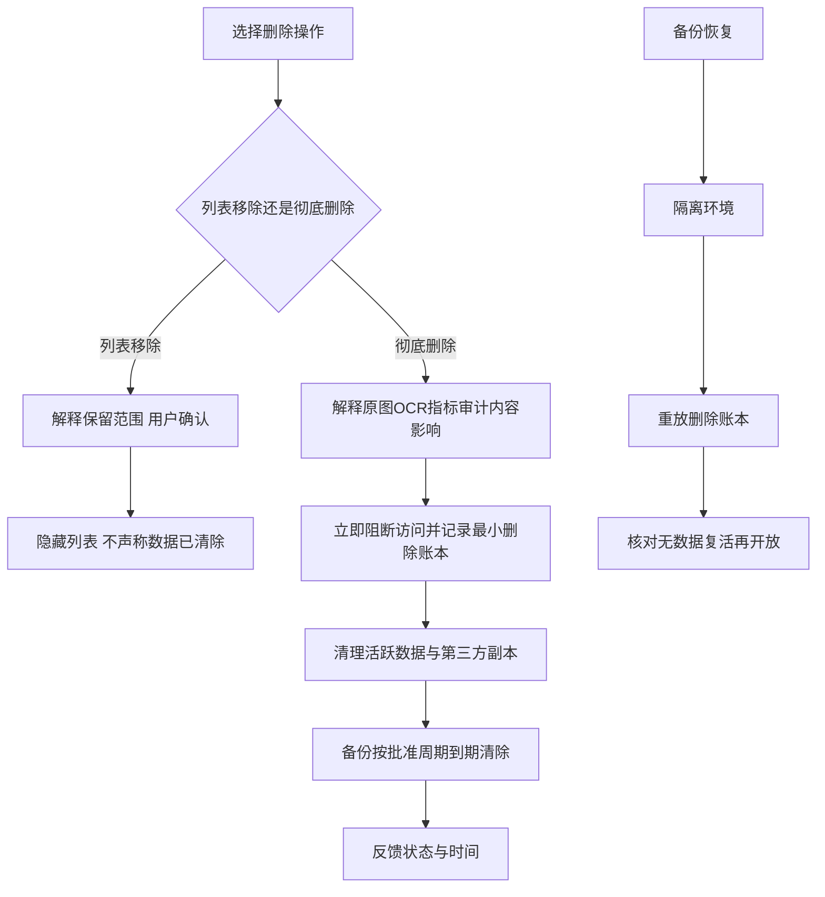

# 04 业务流程图

## 目标、产出与下一步

目标：明确成功、失败与人工确认边界。产出：报告闭环、就诊闭环和删除流程。下一步：逐节点与FR-004～017、接口与测试对应。状态：设计建议，未实现。

## 拍照上传到图表

临时指标节点依据 DEC-015（2026-10-20 已确认），标准字典命中项正常进入逐项确认；不匹配上述归并条件的未知项保留独立临时指标后进入确认。草稿中的合并前后图表仅作标明“预览”的模拟，不写入正式趋势；图示手动操作的审计随操作记录，不能让草稿绕过确认。合并临时指标身份不等于合并原始报告或证明医学等价；正式图表仍按单位及已知方法/标本分可比组，跨档案结果不纳入查询。MVP 包含自动归并、提示确认/暂不合并、一键撤销及分开展示；v1.1 再提供完整手动归并工具。

OCR自动提取不能跨过确认节点。数据库正式保存与对象存储不是跨系统原子事务：通过任务状态、幂等与补偿处理残留，设计见ADR-004。用户取消不应导致已上传对象无限期留存，待清理规则进入删除生命周期。

## 就医时间线与后续月历

同一天可有多条就诊；如何避免误录重复由提示与用户确认处理，不能以“同一天只能一次”覆盖真实情况。医院名称不与患者病情共享到公开日志。

## 删除与恢复约束

列表移除是否同时退出图表是DEC-002的一部分；本稿建议移除仅隐藏报告列表、正式指标仍保留，必须在确认前清楚告知；彻底删除必须退出图表。建议不等于已批准。

## 待确认事项

- [ ] 列表移除的图表保留语义、残留对象清理时限。
- [ ] OCR重试上限与超时、取消任务的供应商处置。
- [ ] 日期缺失与同日就诊重复提示的交互细节。
