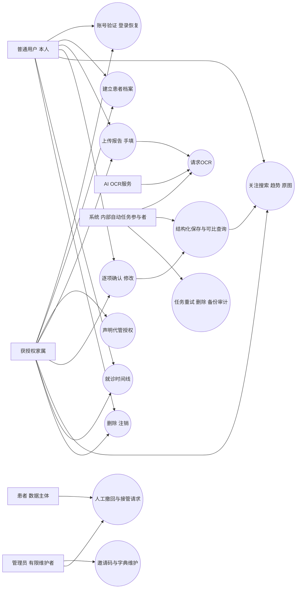

# 05 用例图

## 目标、产出与下一步

目标：明确参与者与系统边界。产出：Mermaid graph模拟用例图及权限说明。下一步：检查每条连线是否有FR/NFR支持。状态：第二阶段评审稿。

## 用例关系

此图不是标准UML：系统节点表示内部自动任务，用来满足参与者展示要求，不代表系统拥有独立法律人格。管理员与OCR服务为外部协作参与者，不赋予它们自由浏览内容的权限。

## 参与者权限

| 参与者 | 能力 | 边界 |
| --- | --- | --- |
| 普通用户 | 本人记录、确认、查询和权利请求 | 仅所属档案 |
| 家属 | 已获授权档案代管 | 画像不改变权限；撤回后立即阻断访问 |
| 患者 | 撤回与接管请求 | MVP人工渠道；v1.1接管能力须核验 |
| 系统 | 执行授权范围内任务 | 不绕过确认或同意；自动任务有服务权限与审计 |
| OCR服务 | 处理指定照片并返回结果 | 合同、境内区域、留存与训练使用核实后启用真实数据 |
| 管理员 | 邀请、字典与权利请求协助 | 默认不能看病历内容或原图；数据库运维能力仍存在风险，需独立密钥与最小权限 |

## 待确认事项

- [ ] 人工核验及异常情况下的数据访问审批机制。
- [ ] 管理职责与部署运维职责是否由同一人承担及补偿控制。
- [ ] v1.1患者接管、多人协作的权限模型另行评审。
