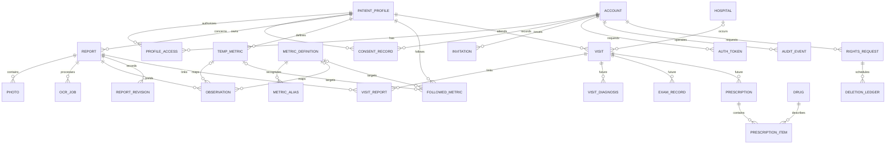

# 06 ER图与数据库概念设计

## 目标、产出与下一步

目标：分离操作者、患者、来源报告和检测结果，保证长期演进与来源可追溯。产出：概念ER与关系规则，不是建表SQL。下一步：核对数据字典、权限和删除依赖。状态：评审稿。

## 概念ER

实体字段以数据字典为唯一详细定义；本图只表达概念关系。未来实体标记future，MVP不因此创建处方/诊断页面或承诺接口。

## 核心建模决定

1. PROFILE_ACCESS为账号与档案的关系。数据上允许多对多，MVP服务层只允许一个账号一个有效档案、一个有效操作者；未来多档与协作需另外授权设计，不只是取消限制。
2. REPORT表示一次资料提交，多张PHOTO属于一份报告；OCR_JOB可多次尝试。原始OCR输出与正式OBSERVATION分离，正式记录只能来自已确认报告。
3. OBSERVATION是具体检查项/结果实例，METRIC_DEFINITION是标准指标定义。同一报告同一指标可有多条，不能以“报告+指标唯一”丢掉同日多次或重复测量。
4. 标准指标与临时指标映射二选一，也可均为空表示未映射。临时项仅限本患者，不共享其名称到全局字典；FOLLOWED_METRIC目标亦二选一。
5. 可比组依据指标身份、原单位及已知标本/方法建立。未知方法不擅自推定等价，界面展示来源局限。自动单位换算不在MVP。
6. VISIT_REPORT为多对多：一报告可关联相关就诊，同就诊可多报告；必须同档案。医院允许手填，HOSPITAL仅标准名称目录，不共享患者自定义备注。
7. REPORT_REVISION保存修改内容与前后版本，属于敏感数据；彻底删除不能只删主表而留完整历史。
8. 删除账本不保存报告内容，仅保留不可逆标识/最小墓碑与状态，期限覆盖备份生命周期；账号注销后不可利用账本重新关联身份。具体保留与法律依据待确认。

## 一致性与生命周期

正式保存需在数据库事务中完成报告状态、确认人/时间、检查项和版本更新；对象存储通过状态机与补偿对账。对象键不是公开URL，不把有权限访问当成“猜不到ID”。所有查询与关联写入同时核对所属档案权限。

建议报告状态：上传中、待识别、识别中、待确认、已确认、失败、已移除、删除中、已删除。列表移除是一种展示状态，原处理阶段另存，不覆盖OCR失败信息。并发确认/修改采用版本校验，版本过期拒绝覆盖。

彻底删除先禁访问，再清理照片、OCR、检查项、版本及关联关系；保留就诊本身时移除报告关联即可。账号注销还涉及授权、凭据、关注和临时指标。图片去重提示采用内容摘要，摘要也按档案隔离，不暴露他人是否上传过相同文件。

## 待确认事项

- [ ] 关联关系、日期精度、未知可比性与移除语义。
- [ ] 标准医院目录是否首版必要；建议允许没有标准医院ID。
- [ ] 备份、删除账本及修改审计的期限与加密方案。
- [ ] 后续药物数量单位、处方频次不在首版物理建模中提前定死。
