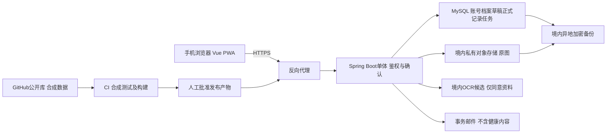

# 13 技术选型建议

## 目标、产出与下一步

目标：兼顾完整工程学习、个人可维护性和500元年度上限。产出：方案比较、成本模型与信任边界。下一步：按已确认 DEC-012 版本系列核验补丁、兼容性与维护周期，继续确认其余 DEC 与报价，不安装工程、不部署。

## 比较建议

| 项目 | 推荐及理由 | 替代方案 | 学习价值 | 成本与难度 |
| --- | --- | --- | --- | --- |
| 前端 | Vue 3.5.x + TypeScript 5.6.x + Vite 6.x + Pinia 2.x、PWA；符合Vue偏好、浏览器即可用；按 DEC-018 采用 WCAG 2.2 AA 基线，文本对比度≥4.5:1，支持200%缩放、可见焦点、自动填充、避免冗余输入和一致帮助入口，提供主题/字号、键盘焦点与屏幕阅读器支持，触控目标按项目基线≥44×44 CSS px | uni-app后续评估；原生开发学习面更广但工时高 | 组件、状态、类型、移动交互、无障碍与缓存边界 | 工具免费；中等；PWA不依赖推送/离线/后台同步；具体实现和验证尚未完成 |
| 图表 | ECharts 5.5.x，时间轴与点提示成熟 | Chart.js较轻；自绘成本高 | 可比组、缺失/非精确值表达 | 开源；中等；查许可与触控表现 |
| 后端 | JDK 21 LTS + Spring Boot 3.4.x 模块化单体；按账号/报告/指标/就诊/权利划模块 | Node/其他Java框架；微服务不适合本阶段 | 事务、权限、接口、任务、集成测试 | 开源；中高；版本系列已按 DEC-012 确认，支持周期与兼容性在编码前核验 |
| 数据库 | MySQL 8.4 LTS，关系约束适合来源与就诊关联 | PostgreSQL类型更丰富；SQLite部署轻但并发与工程目标不同 | 索引、事务、约束、迁移与备份 | 软件免费自管有维护成本；中等 |
| 数据访问 | MyBatis 3.5.x，便于显式学习查询和SQL；映射边界仍待 DEC-022 | Spring Data JPA便捷但隐式行为需理解 | 查询计划、映射及事务边界 | 免费；中等；不在此输出SQL |
| OCR | 可替换境内云OCR适配器+人工确认，先合成数据评测再采购 | 腾讯云/阿里云/百度云比较；自建OCR为v2学习；通用视觉大模型需额外评估幻觉留存成本 | 第三方契约、任务重试、字段映射与评测 | 按图/请求计费；失败部分也可能收费；中高；供应商未定 |
| 对象存储 | 境内私有COS/OSS候选；权限独立、图片不放公开桶 | 服务器本地目录便宜但迁移/备份压力大；自建MinIO需运维 | 对象生命周期、访问代理与删除对账 | 请求/容量/外网流量/版本费用另计；中等 |
| 部署 | 一台境内小型云服务器，前端反向代理+后端+MySQL；容器化候选 | 托管数据库成本高；单机直装更直观但复现弱 | Linux、网络、容器、资源限制与回滚 | 促销价不代表续费，内存需验证；中高 |
| 域名 | 常见后缀正规注册商，预算包含续费 | 免费子域名可演示但不符合自有域名目标 | DNS、备案、邮件认证 | 按首年/续费实际报价；低中 |
| HTTPS | ACME免费证书自动续期，Nginx或Caddy终止TLS | 云证书服务；手动续期易遗漏 | TLS、DNS校验、证书过期监测 | 证书可免费但域名服务器有费；中等 |
| 邮件 | 境内事务邮件服务候选、独立发信域名，核实个人主体开通 | Resend仅作为跨境候选比较；不QQ SMTP直发 | SPF/DKIM/DMARC、送达与令牌安全 | 配额/计费资格待核实；不以免费代替合规 |
| CI/CD | GitHub Actions关键测试/构建；初期人工批准发布 | 其他CI或自托管需要维护 | 流程、产物、密钥与回滚 | 公共库配额政策核实；测试无真实数据；中等 |

DEC-012 已由项目发起人于 2026-10-20 确认：JDK 21 LTS、Spring Boot 3.4.x、MySQL 8.4 LTS、Vue 3.5.x、TypeScript 5.6.x、Vite 6.x、Pinia 2.x、MyBatis 3.5.x、Flyway 10.x、ECharts 5.5.x。Flyway 用于数据库迁移，相关失败处置和许可细则继续由 DEC-019 维护。以上为版本系列基线，不是最新版本或兼容性验证结论；补丁版本、PWA 插件版本、依赖许可、安全更新窗口在编码前核验并锁定。单机不等于高可用；故障恢复靠可用备份而不是宣传连续服务。

## 架构与信任边界

同源部署与服务端会话为ADR-007候选，浏览器不把长期令牌存localStorage；密钥不与加密数据同一公开配置保管。OCR输入原图本身敏感，传输及供应商处理都属于风险边界；模型置信度必须来自真实返回，不能编造。

## 年度预算模型（不是报价）

建议分配上限：服务器250、域名60、对象存储与流量40、OCR40、邮件20、异地备份40、预留50元，合计500元。这仅是目标配额，尚无满足全栈配置的已核实报价；首年和续费均须核算。若服务器续费已超预算，不能通过取消加密/备份弥补。

实际总额=服务器+域名+对象容量/请求/下载流量+OCR成功及收费失败调用+邮件+备份容量/流量+税费与预留。批量重试/恶意上传需限额。先用合成数据估算每报告图片大小、页数和调用数，给出每月/年预算。

## 来源与核实限制

[腾讯云OCR计费说明](https://cloud.tencent.com/document/product/866/17619)说明部分错误也计费，具体接口/配额下单前核实；[腾讯云SES产品](https://cloud.tencent.com/product/ses)提供API/SMTP，产品介绍不证明个人主体可用或数据在指定区域；[Resend价格](https://resend.com/pricing.md)列免费每月3000、每日100邮件，仅说明当次页面信息，不解决跨境处理问题。供应商隐私、训练和删除仍需合同核查。平台价格可能变化，文档不提供永久报价或绝对准确率承诺。

## 待确认事项

- [ ] DEC-004真实首年/续费成本；DEC-005/006供应商主体、地区与条款。
- [x] DEC-012 技术版本系列于 2026-10-20 确认，见本页版本基线与决策台账。
- [ ] 补丁版本与兼容性、维护周期、PWA 插件、数据访问映射边界、部署方式与反向代理。
- [ ] OCR比较用合成数据集、字段准确率与错误类型，不能只比较总体识字率。
