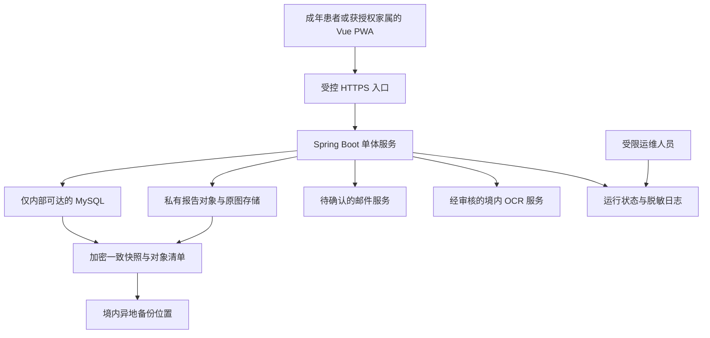

# 17 部署与运维方案

## 目标

为 Vue PWA、Spring Boot、MySQL 的 HealthTrace MVP 提供可负担、可维护、有安全门禁的部署运维建议。本文仅描述方案，不实际申请资源、配置服务、执行部署或迁移，不含代码、命令或 SQL。

## 产出

产出最小部署拓扑、环境与访问边界、发布回退流程、人工运维清单、费用核算及上线门禁。所有资源选择和参数均为建议，待对应 DEC 确认；本文不证明系统已上线或通过验证。

## 规模与约束

计划邀请 2–3 位家人使用，开发每周 8–12 小时、预计 3–5 个月，年度总费用目标不超过 500 元。以上是计划估计，不是报价或容量实测。采用简单单体，不引入微服务、Kubernetes 或复杂监控。P0 安全不可因资源不足或预算缩减而降级，预算不足应缩小非核心范围或延迟真实数据上线。

MVP 一账号一个患者，但底层支持多档案。本人及授权子女、配偶均围绕成年患者；保留授权声明与时间戳，不强制身份证。管理员默认无病历内容浏览权限，运维身份也不自动获得应用内内容权限。

## 建议部署拓扑

图中箭头表示逻辑依赖，不代表已配置网络或每条直连通道均可公开访问。具体同机或托管方式须结合报价与资源确认。单一主机可能降低费用，但存在共同故障域；异地备份不得与主节点共享唯一存储或唯一密钥恢复路径。

## 环境与数据边界

开发和测试仅使用合成数据；与未来生产账号、密钥、对象位置及邮件/OCR 配置分离。真实数据启用前必须完成供应商、必要同意、法律与备案适用性核实，以及权限、删除和恢复测试。

PWA 静态资源可缓存，但病历内容、原图、OCR、接口结果及授权凭据不得因离线缓存或账号切换而泄漏。共享设备上退出、会话失效及应用更新均需验证清理行为。未验证邮箱可登录，但服务端必须拒绝真实病历上传和密码找回，界面提示不能替代权限校验。

数据库不直接面向公网，报告对象为私有，访问时验证账号及患者归属。OCR 传输仅包含必要内容，并符合获审合同、不训练与留存条件；用户拒绝 OCR 可手填。运维日志不记录病历正文、原图、完整 OCR、密码、邮件凭据或密钥；正式修改审计为受限业务记录，不能与一般日志混为一谈。

密码采用 BCrypt。传输与备份加密，敏感存储保护及密钥托管方式需设计评审；密钥与备份分开保存、最小授权，防止机器故障时同时丢失。备份密钥丢失相当于无法恢复，应有受控恢复资料和演练证据。

## 外部依赖与任务

OCR 服务不可用时任务进入明确失败或待处理状态，允许手填或有界重试，不允许未确认草稿成为正式数据。任务保存及回调处理须幂等。邮件失败应有可见状态和人工排查路径，不得绕过邮箱验证直接开放真实数据能力；邮件供应商、域名验证、送达限制及费用待 DEC-006。

真实数据前应确认境内 OCR 供应商合同、不训练条款、留存时间、删除机制、必要同意与适用义务。供应商承诺必须有证据，不能以控制台选项代替合同核查；未决时继续使用合成数据。供应商停用时需能关闭外发并保留手填路径。

## 发布与回退流程

1. 固定待发布版本、需求变更与配置清单，确认数据库及对象模型兼容性、外部依赖和费用变化。
2. 在隔离环境使用合成数据执行与变更相关的验收，P0 与恢复证据不齐不得进入真实数据试用。
3. 核验近期可恢复快照、密钥和最小删除账本，并明确维护窗口、责任人及回退触发条件。
4. 执行经审查的发布操作后，检查登录验证、权限隔离、上传到草稿、逐项确认、图表、就诊、任务与审计的合成冒烟结果。
5. 观察错误和任务积压，记录发布结果；异常按预定触发条件停止新增写入或回退。

应用回退需保证旧版本理解当前数据；不兼容的数据变更不能靠应用版本回退解决，须先评估写入及迁移影响。任何数据恢复都按 [18-备份与恢复方案](18-备份与恢复方案.md) 进入隔离环境并重放删除账本，不能直接开放旧备份。发生故障后的回退同样不能恢复已撤回授权或已删除内容。

## 最小运维工作

- 每日自动检查并人工关注：服务存活、错误摘要、OCR 失败与积压、磁盘/对象容量、备份成功及一致性；失败必须可见，不要求复杂监控平台。
- 每周人工复核：待处理任务、授权撤回与注销申请、删除时限、备份到期、异常登录、费用增长和依赖服务变更。
- 发布及重要变更时：验证权限、配置与日志脱敏，复核恢复能力、依赖漏洞处置和移动端兼容。
- 证书、域名及服务到期前：安排提醒与续费核实，避免以人工记忆作为唯一保证。

故障记录包括发现时间、影响范围、是否涉及内容、处置与恢复时间、证据及后续措施。权限问题或敏感数据事件应优先阻断相关访问、停止外发并保护审计，随后评估适用通知义务，不在运维记录传播病历正文。

## 删除与人工管理

列表移除、彻底删除、注销与授权撤回分别建单处理，向用户说明后果。彻删建议立即禁访问、24 小时内活跃清除、30 天内随备份到期，尚待 DEC-002，不能作为已承诺时限。需覆盖报告图像、缩略图、OCR、草稿、正式结果、图表缓存、任务与供应商副本。

人工撤回为 MVP；申请核验、阻断访问、处置记录与告知需明确负责人，自助撤回及接管属于 v1.1。管理员仅管理字典、邀请等职责，不允许以排障为由默认读取病历。紧急介入如确有必要，应另行评估授权与留证，不能在本方案中预设广泛内容访问权。

## 成本与容量核算

DEC-004 应核算服务器、域名、数据库与对象容量、境内异地备份、OCR 调用、邮件、流量及必要安全支出，注明计费周期、免费额度限制、续费价及超额费用。不得写成已经取得的低价方案。每日加密数据库和对象清单一致快照、30 天滚动备份会增加容量与流量，需共同计入预算。

容量观察至少包括报告份数、每报告图数与大小、对象增长、备份增长、任务峰值、响应和内存/磁盘压力。达到容量或费用预警时优先限制新增用量、提示用户和调整范围，不删除未到期备份或关闭安全控制以省成本。阈值待基线测量后确认。

## 上线门禁

允许真实数据前须确认：邮箱门禁与 BCrypt、患者归属隔离、管理员默认不可看内容、逐项确认、授权与必要同意、供应商不训练及留存审查、删除及恢复禁复活、日志与密钥保护；完成适用法律与备案核实。P0 测试须有证据，不能用文档声明代替测试。当前没有实际部署、真实数据或通过记录。

## 来源引用与局限

来源为项目需求基线，相关验收见 [16-测试策略](16-测试策略.md)，恢复细节见 [18-备份与恢复方案](18-备份与恢复方案.md)。安全实现评审可参考 [OWASP ASVS](https://owasp.org/www-project-application-security-verification-standard/)；本文未宣称完成标准认证。未获取云服务报价、境内供应商合同或备案审查结果，所有费用与运行指标均待核实。

## 下一步

核实报价及外部服务条款，确认单体资源与私有对象方案；完成合成环境的 P0 与隔离恢复演练后，再评审真实数据试用。实际部署应另按批准后的操作清单执行，本文不执行操作。

## 待确认事项

- DEC-002：立即禁访问、24 小时活跃清除、30 天备份到期建议及供应商删除证据。
- DEC-003：RPO 24 小时、RTO 8 小时、每日一致快照、境内异地和 30 天滚动建议。
- DEC-004：年度 500 元完整报价与用量预警；资源不足时的范围取舍。
- DEC-005：境内 OCR 合同、不训练、留存、删除与可用性。
- DEC-006：邮件供应商、成本、送达与验证/恢复凭据有效期。
- DEC-007：必要同意、适用备案与法律核实、上线审批责任人。
- 发布、人工撤回、故障响应、密钥恢复及日常检查的具体责任人和提醒方式。
