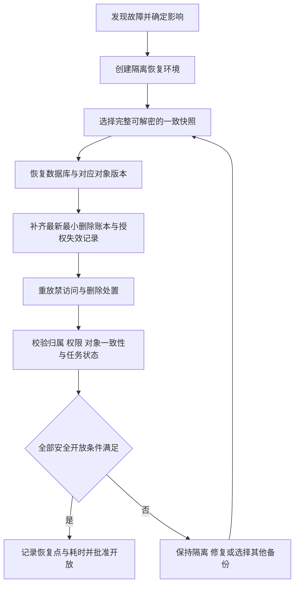

# 18 备份与恢复方案

## 目标

保证报告原图、OCR 草稿、正式结果、就诊关联、授权及审计在故障后可一致恢复，并防止彻删、注销或撤回后的内容因旧备份恢复而再次可访问。本文为设计建议，不执行备份、还原或部署，没有恢复实测证据。

## 产出

产出备份对象与一致性要求、参数草案、隔离恢复流程、最小删除账本设计、演练验收与责任交接要求。验收编号为 TC-107、TC-111 及 TC-203、TC-204，均为未执行，见 [16-测试策略](16-测试策略.md)。

## 参数草案与决策边界

以下全部为建议，待 DEC-003 确认：**RPO 24 小时、RTO 8 小时、每日加密数据库与对象清单一致快照、境内异地保存、滚动保留 30 天**。RPO 是故障时最多可能丢失的近期业务数据目标，RTO 是从故障处置启动到满足安全开放条件的目标时间；两者均不是当前可兑现的保证。

RTO 应包含准备隔离环境、找回密钥、恢复数据库和对象、补齐并重放最小删除账本、校验权限与内容一致性以及批准开放的全部关键耗时，不能只计文件读取时间。每日频率并不自动满足 RPO：备份失败、链条不可解密或一致性不成立时，实际可恢复点会落后，须检测并补救。

DEC-002 删除参数草案为：彻删立即禁访问、24 小时内清除活跃副本、30 天内随备份到期；这些不是已批准承诺。删除后在备份中暂存不等于允许恢复后重新访问。供应商留存与删除必须单独核实，不能推断与本地备份周期一致。

## 备份范围

- 数据库：患者归属、成年及授权声明/时间戳、报告页关联、历史报告日期、OCR 任务与草稿、正式指标、参考范围、就诊与报告关联、字典/临时指标、关注顺序、受限修改审计及删除标记。
- 私有对象：原图、报告页与必要衍生图像，按清单对应报告和患者；OCR 原始输出若以对象形式存放也须纳入。
- 恢复资料：应用版本、配置说明、存储结构、必要恢复元数据和密钥识别信息；不将可直接使用的解密密钥与备份放在同一开放位置。
- 最小删除账本与授权失效处置记录：独立于旧业务快照可恢复，支持恢复前补齐最新禁访问范围。

可重建的图表或缓存不必作为唯一恢复依据，应从已确认正式数据生成；缓存必须先清除再按当前权限重建。运维日志不得以备份之名额外保存病历正文、完整 OCR、密码或密钥。审计留存期限及去标识化方式需与删除、法律评估共同确认。

## 一致快照与完整性

“数据库备份加一份对象清单”本身不证明一致。快照应具有共同备份标识、明确时间点或受控写入边界，清单记录对象标识、关联、完整性校验与可恢复版本，且所有被数据库正式引用的对象版本确实被保留。

多图上传、OCR 运行和正式确认在备份边界附近可能尚未完成：方案应区分正式引用、草稿、临时对象和未完成任务，允许恢复为待处理，不允许恢复为虚假已完成。若底层对象无版本能力，则需要冻结相关写入或采用受控完成边界等经评审的一致性措施；具体实现待确认，不能默认清单能够还原已覆盖或已丢失对象。

备份完成后验证可解密、清单完整、数据库与对象引用可对齐。缺对象、损坏、未完成或缺密钥的备份不得标记为可恢复。采用境内异地位置以降低单机或同一故障域风险，访问受限且加密；异地并不代表跨境。保留及轮转失败应产生可见告警与人工处置记录。

## 最小删除账本

旧快照可能没有之后发生的删除、注销或撤回，因此需独立保存、受限访问的最小删除账本。账本只包含重放所必需的信息，如不透明患者/报告/对象标识、事件类型、失效或删除时间、覆盖范围与完成状态，不保留病历正文、指标值、原图或 OCR 内容；标识仍可能属于个人信息，须最小授权和加密保护。

彻删或撤回请求一经确认，先记录禁访问状态及重放事件，再处理异步清除，防止已确认请求因故障丢失。账本更新的持久化与恢复链路必须独立于每日旧快照，并能补齐故障前已接受事件。若最新账本缺失或其完整性无法确认，恢复服务继续隔离，不能以业务 RPO 允许丢失近期数据为理由放弃删除事件。

账本应至少覆盖所有仍可能恢复的快照和正在处理的恢复任务，具体期限、到期销毁与授权失效记录的分离方式待 DEC-002、DEC-003 及法律评估确认。该机制不得演变为永久保存完整患者身份或病历的第二数据库。

## 删除生命周期

1. 区分列表移除与彻删：列表移除只改变展示或关联状态，不能向用户声称病历已彻底删除；具体可见范围由需求设计确定。
2. 彻删确认后立即阻断应用内容访问、对象访问与任务继续生成，持久记录最小删除事件。
3. 按批准时限清理活跃数据库、原图和衍生物、OCR 结果、草稿、正式结果、缓存及待执行任务，并处理供应商副本及留存证据。
4. 旧备份依批准滚动周期到期销毁；未到期备份保持受限且不得直接开放恢复，记录到期与销毁结果。
5. 注销、人工撤回按各自影响范围停止访问并执行批准的数据处置，不把撤回自动等同于所有法定留存资料都立即消失。

草案 24 小时与 30 天均待确认；第三方无法支持时不能暗示已满足，应保持真实数据门禁关闭或更换符合要求的方案。

## 隔离恢复流程

隔离环境应禁止普通用户访问及未经审核的 OCR/邮件外发，避免恢复过程触发重复通知、重复 OCR 或重新产生已删数据。先恢复加密与权限资料，再检查数据库、对象及清单；补齐并重放删除账本后清理不可访问对象及缓存，处理撤回、注销和待处理任务。

开放前必须证明：患者归属正确，管理员默认无内容权限；已删内容不可被直接对象访问、界面、图表或任务回调取回；未确认草稿不进正式图表；就诊关联完整且不按报告数计数；18 标准指标及临时指标映射可追溯；参考范围、单位/方法/标本分组与审计正确。对不确定恢复状态的任务采用待处理及人工检查，不能自动当作成功。

最终记录可恢复业务时间点、故障时刻、最新删除事件覆盖点、启动到安全开放耗时、丢失范围、残留风险、批准人及后续处理。RPO 与删除账本覆盖分开报告。正常恢复目标未达标时仍须坚持隔离与删除门禁，不以赶 RTO 为由提前开放。

## 演练与验收

建议在首次真实数据前、恢复机制重大变更后及定期安排合成数据演练，频率待责任人与成本确认。演练包含：可用备份恢复、故意缺对象或损坏快照、密钥恢复、删除前备份恢复、撤回/注销后恢复以及运行中任务恢复。

- **TC-107 / NFR-007**：实测可恢复点、全过程耗时、数据库/对象一致性和密钥可恢复性，对照批准参数。
- **TC-111 / NFR-011**：检查活跃清除、供应商处置、备份到期及删除账本覆盖，已删内容不可访问。
- **TC-203**：恢复删除之前的合成快照，确认最新账本重放后被删内容不会重新开放。
- **TC-204**：故意制造数据库与对象不一致，确认问题被发现并保持隔离。

上述均 **未执行**。只有实际记录才能支持“可恢复”和 RPO/RTO 达标；备份成功消息不能替代还原演练。演练证据应包括快照标识、合成样本说明、校验结果、账本覆盖、计时及缺陷复验。

## 责任与故障处置

备份责任人检查每日结果和到期，恢复责任人执行隔离恢复，批准人确认开放条件；个人项目可由同一人承担，但各检查和决策仍需分别留证。密钥及必要交接资料应受限且在主机失效时可找回。发现备份失败、损坏、空间不足或账本缺失时评估恢复点并优先修复；无法保证恢复和删除一致性时暂停真实数据新增或保持恢复环境隔离。

## 来源引用与局限

来源为本轮需求基线与 [17-部署与运维方案](17-部署与运维方案.md)、[16-测试策略](16-测试策略.md)。本文件未核验实际数据库备份机制、对象版本能力、供应商留存或报价，也没有执行恢复。RPO/RTO、保留周期和删除时限只为建议，具体法律义务以 [10 风险清单与合规注意事项](10-风险清单与合规注意事项.md) 及对应 DEC 核实为准。

## 下一步

确认 DEC-002 与 DEC-003 后选择可实现一致快照的方案，核实境内异地空间及密钥恢复成本；准备合成数据、删除事件与故障样本，完成隔离恢复演练并回填 RTM 后再评审真实数据试用。

## 待确认事项

- DEC-002：立即禁访问、24 小时活跃清除、30 天备份到期及账本期限、供应商删除证明。
- DEC-003：RPO 24 小时、RTO 8 小时、每日加密一致快照、境内异地、滚动 30 天及演练频率。
- DEC-004：备份容量、流量、对象版本与密钥恢复是否能纳入年度不超过 500 元目标。
- DEC-005：OCR 留存及删除机制，与本地恢复/删除流程如何对齐。
- DEC-007：删除、审计及最小账本必要留存的法律评估结果。
- 主体备份及最小账本的独立持久化方式、完整性证明、恢复责任人和开放批准人。
