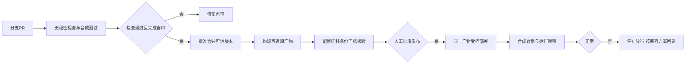

# 28 CI/CD工作流设计

## 目标、产出与下一步

目标：模拟可信的公司集成与发布流程，同时保持单人维护可行。产出：事件、检查、产物、审批、失败处置与回退设计。状态：ADR-011提议配套稿，没有创建工作流配置或执行Git/发布操作。下一步：第二阶段评审后确认DEC-021；编码获准后再实现自动化。

## 工作流分层

| 触发/阶段 | 检查与产出 | 权限与放行 |
| --- | --- | --- |
| 文档PR | Markdown链接、编号、必要章节与Mermaid语法检查候选 | 只读仓库，无部署秘密；当前这些只是设计要求 |
| 功能PR | 静态检查、类型检查、规则单元测试、必要MySQL集成与构建 | 合成数据；外部OCR/邮件默认替身；失败阻止合并 |
| 可信主分支版本 | 生成前后端同一版本产物及版本/依赖/测试摘要 | 不直接推main；产物绑定提交身份，不能混用来源不明构建 |
| 发布准备 | 确认变更、TC证据、DEC门槛、迁移兼容、恢复资料与配置清单 | 项目发起人明确批准；分支/环境保护功能可用性需核实 |
| 生产交付 | 发布已审查的同一产物，受控执行迁移，合成冒烟 | 最小部署身份、维护窗口；不将真实报告复制到CI |
| 发布观察 | 存活、错误摘要、任务积压、容量与费用 | 异常停止新增写入或回退；记录结果与待处理问题 |

## 安全与数据边界

不可信PR不得读取生产或邮件/OCR密钥；不在特权上下文检出并运行外部提交，不以工作流事件名推定可信。公共运行器上没有真实患者数据；不把生产机设成处理外部PR的自托管运行器。Actions权限按任务最小化，第三方动作版本/来源需审阅锁定，依赖更新经验证。日志/缓存/产物禁止密钥、原图、OCR正文与真实配置，缓存仅工具与依赖候选。

CI使用测试邮箱替身与合成数据；供应商契约测试需单独受控凭据、额度及批准，不将外部调用作为每次PR默认步骤。产物留存天数和配额待DEC-004/021，不宣称公共仓库所有能力永久无限免费。Git每项操作仍需先解释并用户确认，设计流程不是执行授权。

## 数据库与回退

迁移由Flyway候选记录版本，部署前先在合成环境验证从空库与上一支持版本升级。结构变更优先兼容当前与待回退应用；生产迁移单执行者、备份可恢复、DDL权限受控。不能假定MySQL DDL失败会自动回滚。破坏性变更单独评审，回退应用前验证数据兼容；不兼容时前向修复或按[备份恢复方案](18-备份与恢复方案.md)隔离恢复，补齐删除账本再开放。

## 验收与失败处置

对应TC-108：失败检查阻止合并/发布、无审批不可上线、产物来源可追溯、旧版本回退兼容性。对应TC-103/110：PR无生产凭据、日志产物无秘密。对应TC-107/111：数据恢复不复活已删内容。全部未执行，不新增虚假通过记录。

上线前八门槛与供应商/备案要求见[验收标准](09-验收标准.md)；自动测试通过不代替合同审查和人工授权核验。若GitHub计划不支持目标审批功能，使用有记录的人工发布门禁，不静默跳过。

## 待确认事项

- [ ] DEC-021触发条件、必需检查、审批机制与实际GitHub功能可用性。
- [ ] DEC-019迁移工具和失败处置；DEC-004/012配额、产物留存与精确版本。
- [ ] 部署身份、配置注入、维护窗口和恢复责任人；真实凭据不进入本文件。
